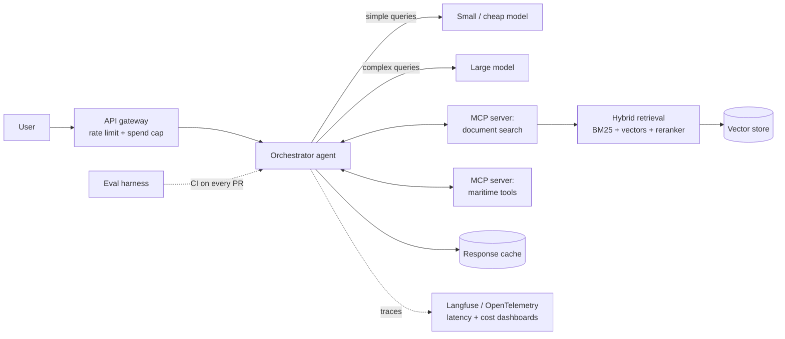

# maritime-rag-agents

> A production-grade multi-agent assistant over public maritime documents, built for **reliability** and **controlled cost**.

**Status:** 🚧 Week 1 (skeleton). See the [roadmap](#roadmap).

## Problem

Maritime professionals work with large, dense document sets: regulations (IMO, MARPOL, SOLAS), port notices, charter party clauses and market reports. Finding a precise, sourced answer is slow, and generic chatbots hallucinate.

This project builds an assistant that:

- answers questions with **citations** to the source documents,
- uses **tools through its own MCP servers** (document search, lookups, calculations),
- is **measured**: every change runs against an evaluation set,
- runs in **production conditions** (Kubernetes, CI/CD, tracing), with a known **cost per 1,000 requests**.

The maritime setting proves the domain. The architecture is generic and will be reused in a second domain.

## Architecture

## Repository layout

| Path | Contents |
|---|---|
| `services/` | Orchestrator agent, MCP servers, API |
| `evals/` | Test set, automated scoring, regression checks |
| `infra/` | Terraform, Helm charts, Kubernetes manifests |
| `docs/decisions/` | Architecture decision records (why each tool was chosen) |
| `.github/workflows/` | CI: lint, tests, evals, secret scanning |

## Roadmap

- [x] Repo, README skeleton, architecture sketch *(week 1)*
- [ ] MCP server and agent running locally *(weeks 1-3)*
- [ ] RAG pipeline and evaluation harness *(weeks 4-6)*
- [ ] Terraform, Helm, CI/CD, cloud deploy *(weeks 7-9)*
- [ ] Observability, cost analysis, public demo, write-up *(weeks 10-12)*

## Cost analysis

*To be published.* Target format: "this design costs X per 1,000 requests; routing simple queries to a smaller model plus caching cut it by Y%."

## Data

Public or synthetic data only. No employer data, documents or code.

## License

[MIT](LICENSE)
